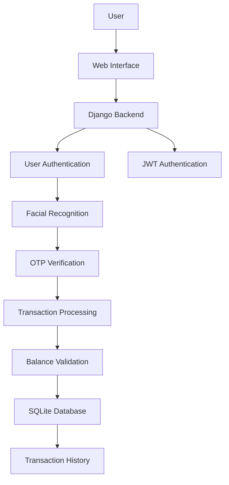
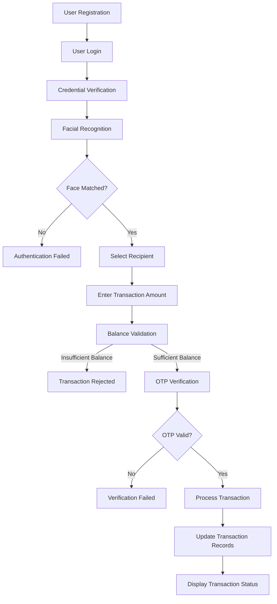
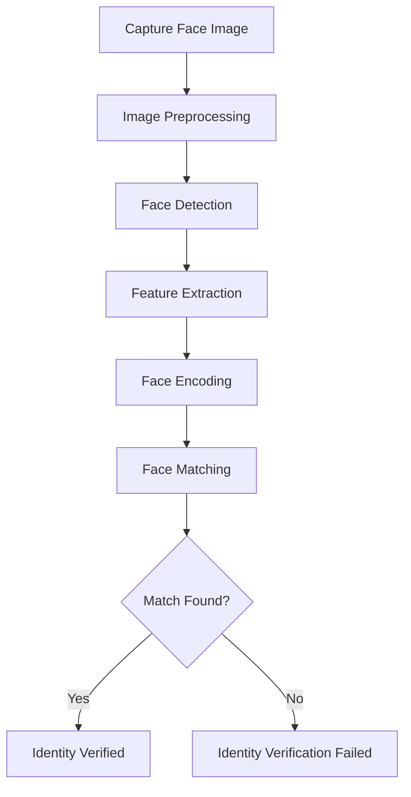

## Machine Learning Based Secure Cardless Financial Transactions Using Multi-Factor Authentication

A secure Django-based web application that enables users to perform cardless financial transactions using multi-factor authentication. The system integrates machine learning-based facial recognition and OTP verification to enhance transaction security and prevent unauthorized access.

## About the Project

Traditional financial transactions often rely on physical cards, passwords, or PINs, which may be vulnerable to unauthorized access.

This project aims to provide a secure and convenient cardless financial transaction system by integrating facial recognition, OTP-based verification, and secure transaction management.

The application is developed using Python and Django, with SQLite as the database. It incorporates JWT authentication, Fernet encryption, and UUID-based transaction identification to improve security and reliability.

## Project Objectives

- Develop a secure cardless financial transaction system.
- Implement facial recognition for user identity verification.
- Integrate OTP-based multi-factor authentication.
- Reduce the risk of unauthorized financial transactions.
- Maintain secure transaction records and history.
- Provide a user-friendly web interface for financial operations.

## Key Features

- User Registration and Login
- Facial Recognition Authentication
- OTP-Based Verification
- Secure Cardless Financial Transactions
- Recipient Management
- Account Balance Validation
- Transaction History Management
- JWT-Based Authentication
- UUID-Based Transaction Identification
- Secure User Session Management

## Technology Stack

### Frontend
- HTML5
- CSS3
- JavaScript

### Backend
- Python
- Django

### Machine Learning and Computer Vision
- OpenCV
- Dlib
- Face Recognition Library

### Database
- SQLite

### Security
- JSON Web Token (JWT)
- Fernet Encryption
- UUID

## System Architecture

The system follows a web-based architecture in which the frontend communicates with the Django backend. The backend manages authentication, facial recognition, OTP verification, transaction processing, and database operations.



## Transaction Workflow

The application follows a secure transaction process involving user authentication, identity verification, and transaction validation.



## Machine Learning Implementation

The project uses machine learning-based facial recognition to verify the identity of users.

The facial recognition process involves:

1. Capturing the user's facial image.
2. Detecting the face from the captured image.
3. Extracting facial features.
4. Generating facial encodings.
5. Comparing the captured facial encoding with the registered user's encoding.
6. Verifying the user's identity based on the matching result.

### Facial Recognition Workflow



## Multi-Factor Authentication

The application combines multiple authentication mechanisms to improve security.

| Authentication Mechanism | Purpose |
|---|---|
| Username and Password | Verifies user credentials |
| Facial Recognition | Provides biometric identity verification |
| OTP Verification | Adds an additional verification layer |

### Authentication Process

1. The user enters their login credentials.
2. The system validates the credentials.
3. Facial recognition verifies the user's identity.
4. The user initiates a financial transaction.
5. An OTP is generated for verification.
6. The OTP is validated before transaction processing.

This layered authentication approach helps reduce the risk of unauthorized transactions.

## Security Implementation

| Security Mechanism | Purpose |
|---|---|
| JWT Authentication | Supports authenticated access to protected resources |
| Fernet Encryption | Provides authenticated encryption for supported sensitive data |
| UUID | Generates unique transaction identifiers |
| OTP Verification | Adds transaction-level verification |
| Facial Recognition | Provides biometric identity verification |
| Balance Validation | Prevents transactions exceeding the available balance |

## 🗄️ Database Design

The application uses SQLite to store user and transaction-related information.

### Main Database Models

| Model | Purpose |
|---|---|
| UserRegistrationModel | Manages user registration information |
| TokenCountModel | Manages token-related information |
| TransactionModel | Stores transaction-related information |

The database supports user management, authentication-related information, and transaction history.

## ⚙️ Installation and Setup

### Prerequisites

- Python 3.x
- pip
- Git
- Virtual Environment

### 1. Clone the Repository

```bash
git clone https://github.com/siripuramniharika-creator/YOUR_REPOSITORY.git
```

```bash
cd YOUR_REPOSITORY
```

### 2. Create a Virtual Environment

```bash
python -m venv venv
```

Activate the virtual environment.

**Windows:**

```bash
venv\Scripts\activate
```

**Linux / macOS:**

```bash
source venv/bin/activate
```

### 3. Install Dependencies

```bash
pip install -r requirements.txt
```

### 4. Apply Database Migrations

```bash
python manage.py makemigrations
```

```bash
python manage.py migrate
```

### 5. Run the Application

```bash
python manage.py runserver
```

Open the application in your browser:

http://127.0.0.1:8000/

## Testing

The following test scenarios can be used to evaluate the application.

| Test Scenario | Expected Result |
|---|---|
| Valid Login Credentials | User is authenticated |
| Invalid Login Credentials | Access is denied |
| Matching Face | Facial verification succeeds |
| Non-Matching Face | Facial verification fails |
| Valid OTP | OTP verification succeeds |
| Invalid OTP | OTP verification fails |
| Sufficient Balance | Transaction can proceed |
| Insufficient Balance | Transaction is rejected |
| Successful Transaction | Transaction record is created |
| Transaction History | Previous transaction records are displayed |

## Future Enhancements

- Improve facial recognition accuracy under different lighting conditions.
- Introduce real-time transaction fraud detection.
- Implement transaction notifications.
- Add transaction limits and risk-based verification.
- Integrate a secure payment gateway.
- Deploy the application to a cloud platform.
- Improve user interface and accessibility.

## Project Limitations

- Facial recognition accuracy may depend on image quality and lighting conditions.
- OTP delivery depends on the configured communication mechanism.
- The application is a prototype and is not intended for processing real financial transactions.
- Additional security testing and compliance measures would be required before production deployment.

##  Application Screenshots

### 1. User Registration
Displays the registration interface for new users.


### 2. User Login
Provides the login interface for registered users.


### 3. Facial Recognition
Demonstrates the facial recognition authentication process.


### 4. OTP Verification
Displays the OTP verification interface.


### 5. Transaction Processing
Demonstrates the cardless transaction process.


### 6. Transaction History
Displays previous transaction records.


